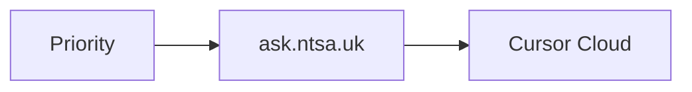
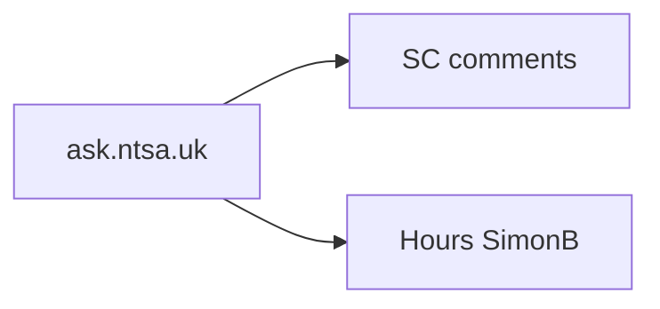
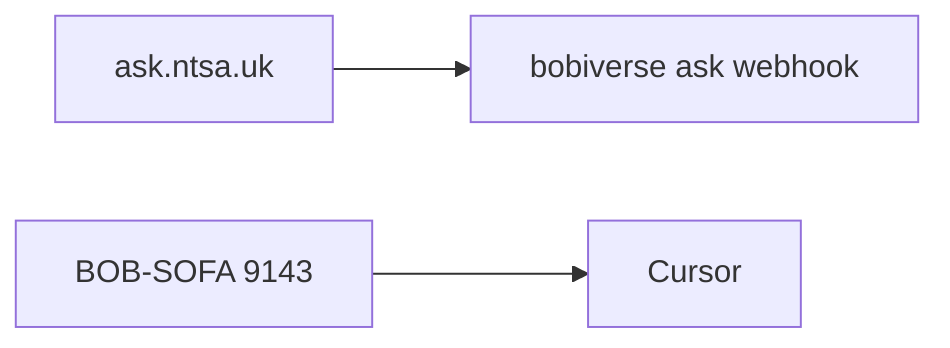

# Vision: ask.ntsa.uk — Priority SC → Cursor Cloud → writeback + hours

**Product:** ask.ntsa.uk  
**App home:** SimonBarnett/priority-mcp (`ask/` folder; sparse checkout deploy)  
**Webhook home:** SimonBarnett/bobiverse (`/bob/v1/ask`)  
**Unconnected to airc.**

## Ultimate objective

From a Priority ERP direct activation that passes a service-call (SC) number, ask.ntsa.uk builds deterministic Medatech context, runs a Cursor Cloud agent (with Priority MCP at mcp.ntsa.uk, SOFA, and Priority SDK docs search), writes fix/suggestions plus clarifying questions back to the SC internal comments, posts hours as SimonB with the locked billing formula, and harvests skills each iteration that learns a playbook.

## Success

| id | metric | target | how measured | fail-when |
|---|---|---|---|---|
| S1 | Activation | POST ask.ntsa.uk with SC → accepted JSON | Worker/app tests + live smoke | Silent drop; invented SC |
| S2 | Context | OData: call + attachments + internal + customer text | Fixture + Medatech read smoke | Missing texts; secrets in logs |
| S3 | Agent | Cursor Cloud + mcp.ntsa.uk; model from web.config | Dispatch evidence + config read test | Agent without Priority MCP; model hard-coded |
| S4 | Writeback | Response → SC internal comments via OData | Fixture + live | Customer-facing field polluted; no write |
| S5 | Hours | SimonB; billable = 15 + 15×floor(wall_min/3) | Unit + OData post test | Wrong user; wrong minutes |
| S6 | Config/secrets | Medatech URL + creds + model in deploy web.config; example only in git | Redaction + example tests | Real secrets committed; hard-coded URL/creds/model |
| S7 | Cross-repo | ask code in priority-mcp; webhook in bobiverse | Issue homes + Depends-on | Jeeves path missing on bobiverse |
| S8 | SOFA | Agent searches Stack Overflow for Agents | Depends-on bobiverse#9143 + skill loaded | No SOFA; invented API |
| S9 | Priority SDK web | Agent searches https://prioritysoftware.github.io/ | Tool/skill + live smoke | Other hosts; invented SDK URLs |
| S10 | Harvest | Each SC iteration that learns a playbook harvests skills | Hook/tests + harvest evidence | Lessons only in chat |

## Shape

LOCKED

Primary: service

Cloudflare edge + ask app + Cursor Cloud + OData. No product web UI. Stubs: docs/mocks/ask/.

## Stack

- Cloudflare Worker / edge for ask.ntsa.uk
- priority-mcp/ask/ including web.config (model, Medatech URL, creds)
- mcp.ntsa.uk Priority MCP catalog
- Cursor Cloud agent
- bobiverse Jeeves Python /bob/v1/ask
- Medatech Priority OData
- bob-sofa (Depends-on bobiverse#9143)
- Live docs: https://prioritysoftware.github.io/

## Architecture

Caption: Priority activation reaches ask then Cursor.

Caption: Ask writes back comments and hours.

Caption: Cross-repo webhook and SOFA dependency.

## Hours formula (LOCKED)

`billable_minutes = 15 + 15 * floor(wall_clock_minutes / 3)` as employee SimonB.

## Depends-on

Parent Digest Depends-on: SimonBarnett/bobiverse#9143 (BOB-SOFA).

## Out of scope

airc / AIRC-HIDE / WCF relay; inventing Medatech tokens; customer-visible comment writeback; omnibus FR.
